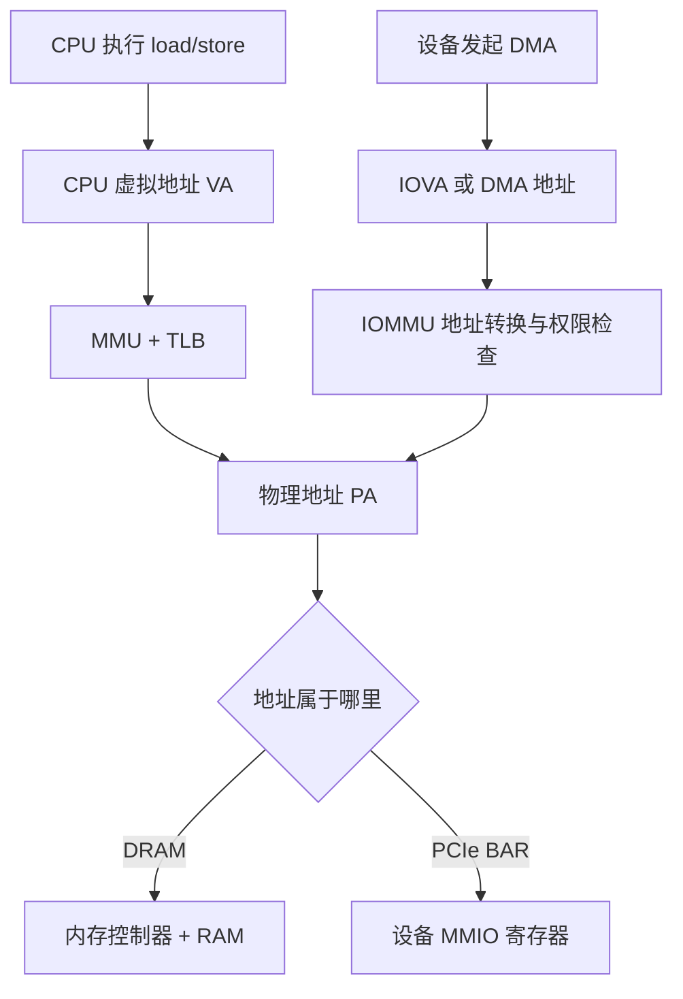

CPU 执行一条 `load` 或 `store` 指令时，使用的是虚拟地址。MMU 把它翻译成物理地址之后，系统再判断这个物理地址对应 DRAM，还是 PCIe 设备的 MMIO 窗口。

设备做 DMA 时，不经过 CPU 的 MMU，而是把 DMA 地址交给 IOMMU。IOMMU 再把设备看到的 I/O 虚拟地址（IOVA）转换为实际物理地址。没有 IOMMU 时，很多设备会直接把地址送上内存总线。

## MMU

## IOMMU

## MMIO

## mmap

## ioremap