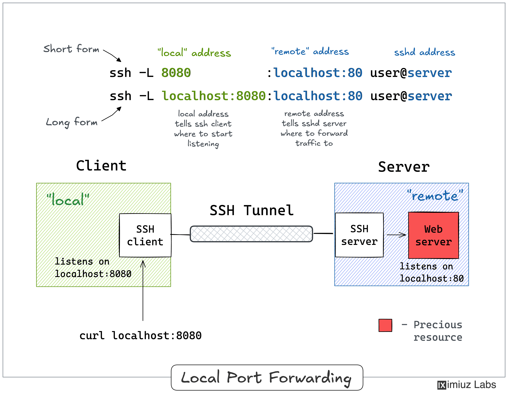
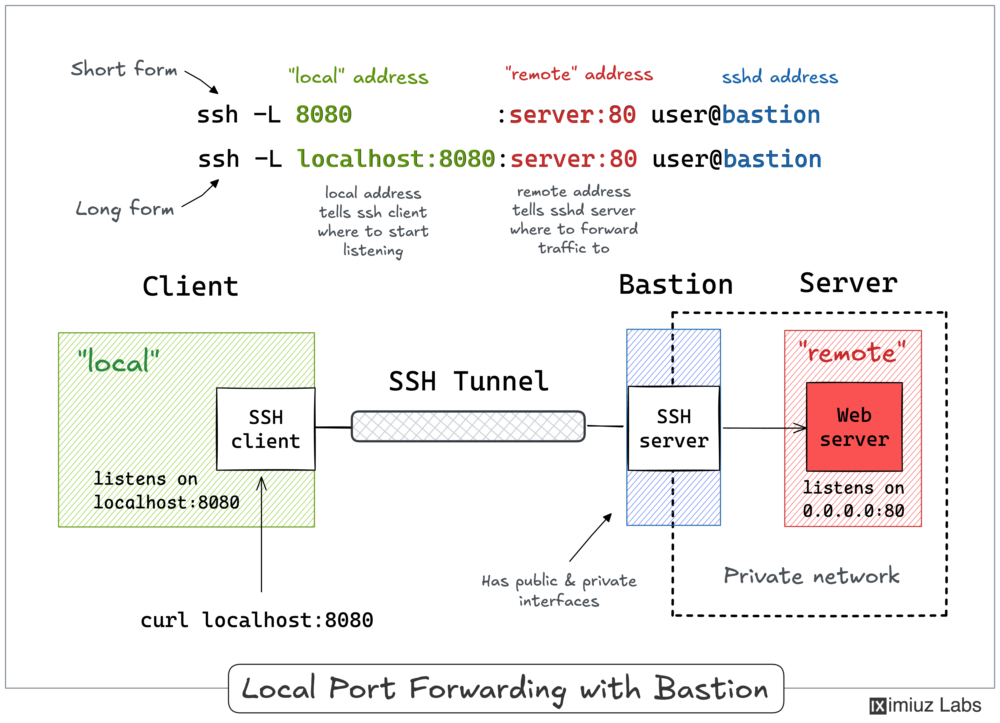
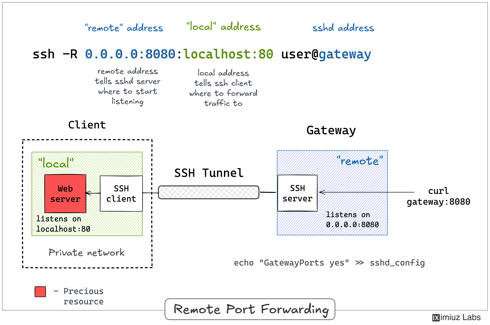

## 本地端口转发

本地端口转发指的是在本机上发起请求，由 ssh client 转发到远程的机器上。它的命令如下：

```bash
sh -L [local_addr:]local_port:remote_addr:remote_port [user@]sshd_addr
```

- 在本地机器上，SSH 客户端将会开始监听 `local_port` 端口（通常也会监听 `localhost` 端口，但具体取决于 `GatewayPorts` 设置）。
- 任何访问此端口的流量都会被转发到 `remote_addr:remote_port` ，从而到达通过 SSH 连接到的远程机器。



## 通过堡垒主机进行本地端口转发

`ssh -L` 命令允许将本地端口的流量转发到任何一台机器的远程端口，而不仅仅是在 SSH 服务器上

```bash
ssh -L [local_addr:]local_port:remote_addr:remote_port [user@]sshd_addr
```



## 远程端口转发

另一个常见的场景是，当希望将某个本地服务暂时暴露给外部世界时。当然，为此，需要一个面向公众的公用接入网关服务器。任何配备了 SSH 守护程序的面向公众的服务器都可以被用作这样的网关。

默认情况下，上述 SSH 隧道只允许使用网关自身的本地主机地址作为远程地址。换句话说，本地端口只能从网关服务器本身内部访问，而这很可能并非真正需要的配置。例如，通常希望将网关的公共地址作为远程地址，以便将本地服务暴露到公共互联网上。为此，需要配置 SSH 服务器以 `GatewayPorts yes` 模式运行。

```bash
ssh -R [remote_addr:]remote_port:local_addr:local_port [user@]gateway_addr
```




## 路由转发

机器 A 配置好本地转发后，A:1234 只能被机器 A 访问，如果本地还有其它机器想访问这个服务怎么办？可以使用 -g 开启路由模式，命令如下：

```bash
ssh -g -L <port_a>:<remote host>:<port_b> user_b@ip_b
```

但要注意的是本地机器间的连接（下图中 X->A、B->C）不是安全连接，所以要谨慎使用。

要注意的是上述方法只对“本地转发”有效，如果想要在远程转发上使用路由功能，需要在“本地”机器 A 中的 `/etc/sshd_config` 中加入 GatewayPorts yes 并重启 sshd 服务：

但默认情况下转发端口仅允许本地访问，不对局域网开放，需要修改​​ `GatewayPorts​​​` 参数位于 `​​/etc/ssh/sshd_config​​`

```plain
GatewayPorts - "Specifies whether remote hosts are allowed to connect to ports forwarded for the client. By default, sshd(8) binds remote port forwardings to the loopback address. This prevents other remote hosts from connecting to forwarded ports. GatewayPorts can be used to specify that sshd should allow remote port forwardings to bind to non-loopback addresses, thus allowing other hosts to connect."
```

取消注释​​ GatewayPorts​​ 并修改默认值 no 为 yes 后重启 sshd 服务即可生效。

该设置允许转发后的端口绑定在 0.0.0.0 上，确保从每个网卡的 ip 上都能访问到 8000 服务。

### 后台执行

即使通过​​ `ssh -Nf` ​​参数后台执行，上述方法缺点依然明显，session 断开后端口转发随之消失。

想要实现类似商用内网穿透的开机自动连接可以使用 autossh 进行自动连接并发送心跳包

### autossh

详见 autossh 部分

## 动态代理

上面的所有方法都只针对一个端口，想要转发所有端口怎么做？

```bash
ssh -D <port> user@remote_ip
```

这个模式对本地和远程转发都有效，它的工作模式和 Shadow Socks 很像，会在本地创建一个 Socks5 代理服务，监听端口 `<port>`，并将所有请求转发到远程机器上
