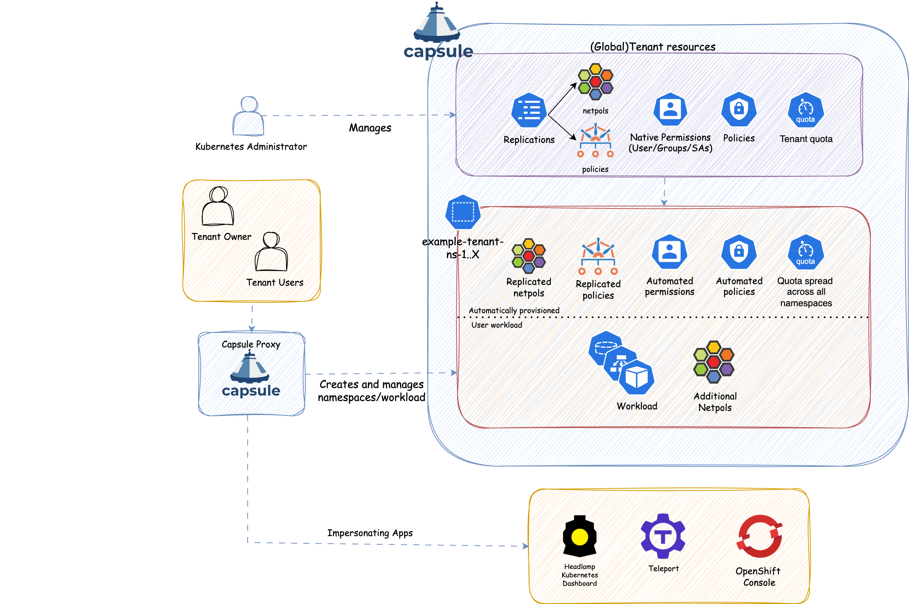

## Capsule

Kubernetes 的多租户管理一直是个复杂的难题。虽然 K8s 本身支持命名空间，但要想实现真正的资源隔离，还需要进行更多的配置。Capsule 这个开源项目正是为了解决这个问题而开发的

Capsule 是一种 Kubernetes 多租户管理解决方案。它允许你将一个 Kubernetes 集群划分为多个独立的 “租户”。每个租户都有自己独立的资源配额和隔离策略。

- <https://projectcapsule.dev/docs/tenants/namespaces/>
- <https://projectcapsule.dev/docs/rules/>

## 多租户解决方案

Capsule 提供了一种创新的方式，允许在单个 Kubernetes 集群中实现高级多租户管理。它的核心思想是通过轻量级的租户抽象（Tenant）将多个命名空间聚合在一起，并通过策略引擎实现租户之间的隔离。

Capsule 架构分为两部分：

- 租户控制器（Tenant Controller）：负责将多个命名空间聚合为一个租户，允许用户在租户内自由创建命名空间并共享分配的资源。
- 策略引擎（Policy Engine）：自动继承租户级别定义的网络策略、安全策略、资源配额、RBAC 等，确保租户之间的隔离。

通过这种设计，Capsule 实现了以下目标：

- 资源隔离：租户之间严格隔离，避免 “邻居噪声” 问题。
- 权限下放：将命名空间管理权限从集群管理员下放给租户所有者（Tenant Owner）。
- 操作自主性：租户用户可以独立管理自己的租户，无需频繁依赖集群管理员。

## 核心功能

### 租户管理

Capsule 引入了 “租户所有者”（Tenant Owner）的角色，允许集群管理员将租户管理职责委派给租户所有者。租户所有者可以在自己的租户范围内创建命名空间并执行管理任务。这种职责分离不仅提高了操作效率，还促进了组织内部的自主性。

### 多租户布局

Capsule 支持多种租户布局：

- Tenant As A Service：租户所有者负责其租户内的所有资源和工作负载，形成共享责任模型。
- Dedicated Nodepool：为每个租户分配独立的节点池，提供强隔离性和安全性。
- Shared Nodepool：多个租户共享节点池，优化资源利用率。

### 策略管理

Capsule 的策略引擎自动继承租户级别定义的策略，包括：

- 网络策略（Network Policies）
- 安全策略（Security Policies）
- 资源配额（Resource Quotas）
- RBAC 权限管理

这些策略确保了租户之间的隔离，同时简化了管理员的工作。
