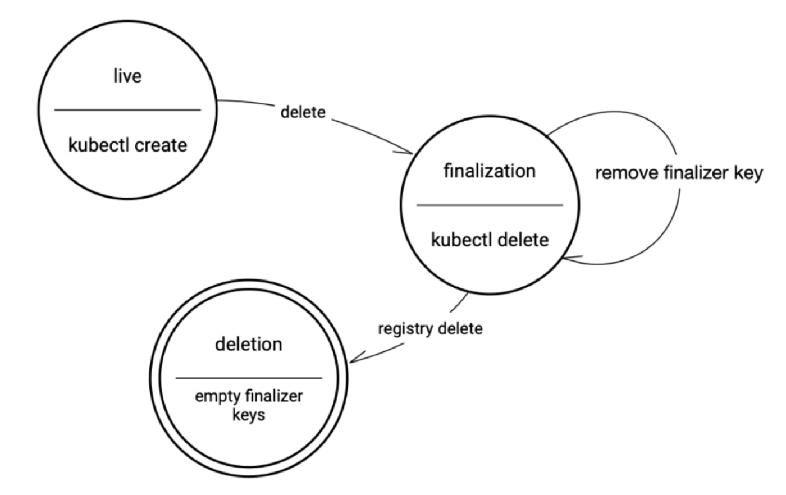

## Deletion

k8s 中，资源的 metadata 中有几个对删除比较重要的属性：

- `ownerRerences`: 指向父资源的 UID
- `deletionTimestamp`: 如果不为空，表明该资源正在被删除中
- `finalizers`: 一个字符串数组，列举删除前必须执行的操作
- `blockOwnerDeletion`: 布尔，当前资源是否会阻塞父资源的删除流程

每一个资源都有 `metadata.finalizers`，这是一个 `[]string`， 内含一些预定义的字符串，表明了在删除资源前必须要做的操作。每执行完一个操作，就从 finalizers 中移除这个字符串。

无论是什么删除策略，都需要先把所有的 finalizer 逐一执行完，每完成一个，就从 finalizers 中移除一个。在 finalizers 为空后，才能正式的删除资源。

foreground、orphan 删除就是通过 finalizer 来实现的。

## Finalizers

Finalizers（终结器）是指示预删除操作的资源的关键。它们是控制资源上的垃圾收集，旨在提醒控制器在删除资源之前要执行那些清理操作。然而，它们不一定应该执行的代码；资源上的终结器基本知识键列表，就像注释一样。与注释一样，它们可以被操纵

下面是一个自定义 ConfigMap，包含一个终结器：

```bash
cat <<EOF | kubectl create -f -
apiVersion: v1
kind: ConfigMap
metadata:
  name: mymap
  finalizers:
    - kubernetes
EOF
```

ConfigMap 资源控制器不理解如何处理 kubernetes 终结器键。以下是尝试删除 ConfigMap 时发生的情况：

```bash
kubectl delete configmap/mymap
```

kubernetes 会报告该对象已被删除，但是，它并没有被传统意义上的删除。相反，它正在删除过程中。当再次尝试 get 该对象时，发现该对象已被修改以及包含删除时间戳

```bash
> kubectl get configmap mymap -o yaml

kind: ConfigMap
apiVersion: v1
metadata:
  deletionTimestamp: '2023-09-18T09:03:50Z'
  resourceVersion: '19551991'
  name: mymap
  uid: 851d8016-9794-4a71-86a0-b8f989955d06
  deletionGracePeriodSeconds: 0
  creationTimestamp: '2023-09-18T09:03:46Z'
  managedFields:
    - manager: Mozilla
      operation: Update
      apiVersion: v1
      time: '2023-09-18T09:03:46Z'
      fieldsType: FieldsV1
      fieldsV1:
        'f:metadata':
          'f:finalizers':
            .: {}
            'v:"kubernetes"': {}
  namespace: default
  finalizers:
    - kubernetes

```

所发生的情况是对象被更新，而不是被删除。这是因为 kubernetes 发现该对象包含终结器并阻止从 etcd 中删除该对象。删除时间戳表明已请求删除，但在编辑对象并删除终结器之前，删除不会完成。

以下是使用 patch 命令删除终结器的演示。如果想删除一个对象，可以简单地在命令行上修补它以删除终结器

```bash
kubectl patch configmap/mymap -n default --type json --patch='[ { "op": "remove", "path": "/metadata/finalizers" } ]'
```

这是最终的状态图



因此，如果尝试删除具有终结器的对象，它将保持终结状态，直到控制器删除终结器建或使用 kubectl 删除终结器。一旦终结器列表为空，kubernetes 实际上可以回收该对象并将其放入队列中以从注册表中删除

## Reconcile 方法中使用 Finalizers

在自定义控制器 Reconcile 中注册和触发预删除钩子

```go
func (r *GuestbookReconciler) Reconcile(ctx context.Context, req ctrl.Request) (ctrl.Result, error) {
	//...
	//...

	// 表示已请求删除
	if !guestBook.DeletionTimestamp.IsZero() {
		err := r.Client.Delete(ctx, &corev1.Pod{
			TypeMeta: metav1.TypeMeta{
				APIVersion: corev1.SchemeGroupVersion.String(),
				Kind:       "Pod",
			},
			ObjectMeta: metav1.ObjectMeta{
				Name:      guestBook.Spec.Name,
				Namespace: guestBook.Namespace,
			},
		})
		if err != nil {
			return ctrl.Result{}, err
		}
		guestBook.Finalizers = []string{}
		if err := r.Update(ctx, guestBook); err != nil {
			return ctrl.Result{}, err
		}
	}

	//...
	//...

	guestBook.Finalizers = append(guestBook.Finalizers, guestBook.Spec.Name)
	if err := r.Update(ctx, guestBook); err != nil {
		return ctrl.Result{}, err
	}

	return ctrl.Result{}, nil
}
```

## 删除策略

k8s 里的 GC 的工作相对比较简单，更像是只是一个被动的函数调用，当用户试图删除一个资源的时候， 就会把这个资源提交给 GC，然后 GC 执行一系列既定的删除流程，一般来说包括：

1. 删除子资源
2. 执行删除前清理工作（finalizer）
3. 删除资源

k8s 的资源间存在上下游依赖，当你删除一个上游资源时，其下游资源也需要被删除，这被称为`级联删除 cascading deletion`。

删除一个资源有三种策略（`propagationPolicy/DeletionPropagation`）：

- `Foreground`(default): Children are deleted before the parent (post-order)
- `Background`: Parent is deleted before the children (pre-order)
- `Orphan`: 忽略 owner references

可以在运行 `kubectl delete --cascade=???` 的时候指定删除的策略，默认为 `foreground`。

### Foreground

1. 设置资源的 `deletionTimestamp`，表明该资源的状态为正在删除中（`"deletion in progress"`）。
2. 设置资源的 `metadata.finalizers` 为 `"foregroundDeletion"`。
3. 删除所有 `ownerReference.blockOwnerDeletion=true` 的子资源
4. 删除当前资源

每一个子资源的 owner 列表的元素里，都有一个属性 `ownerReference.blockOwnerDeletion`，这是一个 `bool`， 表明当前资源是否会阻塞父资源的删除流程。删除父资源前，应该把所有标记为阻塞的子资源都删光。

在当前资源被删除以前，该资源都通过 apiserver 持续可见。

### Orphan

触发 `FinalizerOrphanDependents`，将所有子资源的 owner 清空，也就是令其成为 orphan。然后再删除当前资源。

### Background

立刻删除当前资源，然后在后台任务中删除子资源。

foreground 和 orphan 删除策略是通过 finalizer 实现的 因为这两个策略有一些删除前必须要做的事情：

- foreground finalizer: 将所有的子资源放入删除事件队列
- orphan finalizer: 将所有的子资源的 owner 设为空

而 background 则就是走标准删除流程：删自己 -> 删依赖。
