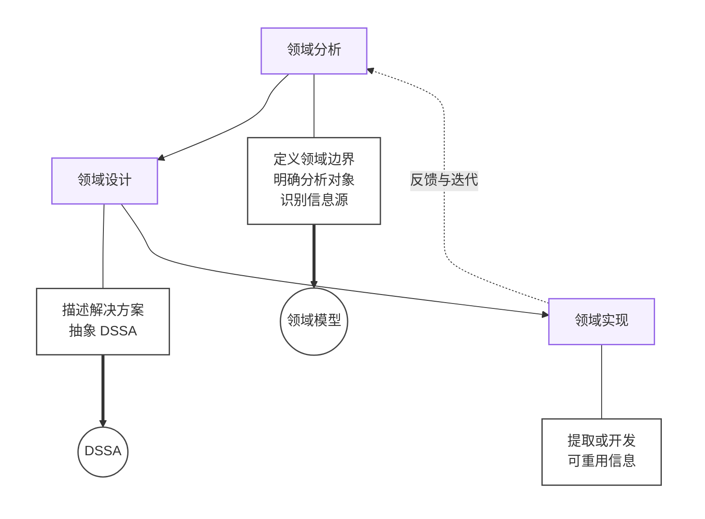

## DSSA

DSSA（Domain Specific Software Architecture）是在一个特定应用领域中，为一组应用提供组织结构参考的标准软件架构。

它的目标是领域级复用：先为一个领域建立参考架构和可复用构件，再基于它们快速开发该领域内的多个系统。

## DSSA 领域

从功能覆盖的范围角度通常有两种理解 DSSA 中领域的含义的方式。

（1）垂直域：定义了一个特定的系统族，包含整个系统族内的多个系统，结果是在该领域中可作为系统的可行解决方案的一个通用软件体系结构。

（2）水平域：定义了在多个系统和多个系统族中功能区域的共有部分。在子系统级上涵盖多个系统族的特定部分功能。

## DSSA 的基本活动

- 领域分析
- 领域设计
- 领域实现

## 参与 DSSA 的人员

参与 DSSA 的人员可以划分为 4 种角色：领域专家、领域分析师、领域设计人员和领域实现人员。
