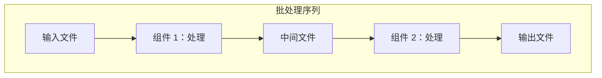
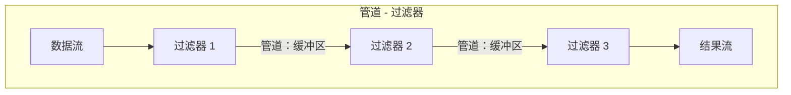
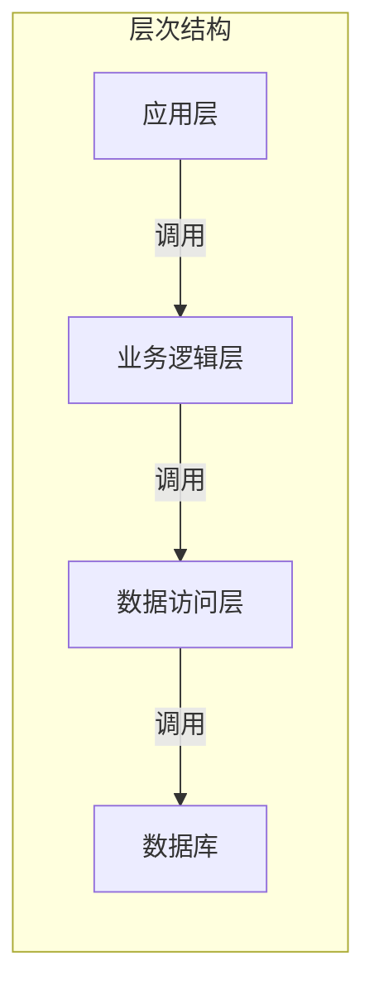
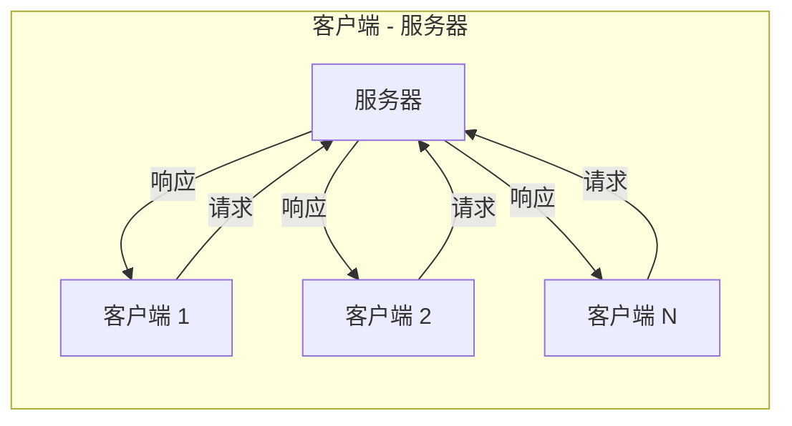
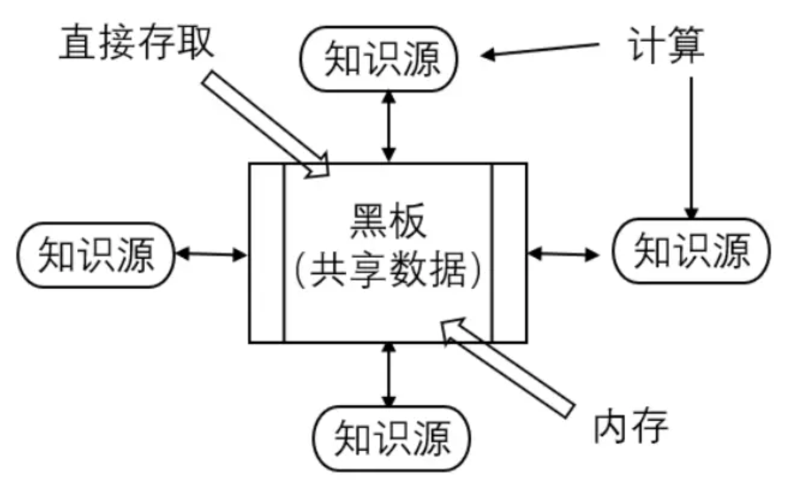

## 软件架构风格

软件体系结构风格（Software Architectural Style）是对软件系统高层组织方式的抽象描述，它定义了一类系统在结构和语义上的共性，包括构成系统的元素类型、元素间的连接件（Connectors）类型以及将这些元素和连接件组织起来的约束和模式。

Garlan 和 Shaw 提出的体系结构风格分类，旨在捕捉不同系统家族在组织结构上的共性模式。一种风格不仅描述了系统的静态结构（组件和连接件），还隐含了其动态行为（交互模式）和非功能性属性（如性能、可修改性、可扩展性）。

核心概念：

- 组件 (Component)：系统中的计算单元或数据存储单元，如模块、对象、数据库、服务器等。
- 连接件 (Connector)：负责协调组件间交互的机制，如过程调用、消息传递、事件、数据流管道、共享内存等。
- 约束 (Constraint)：规定了组件和连接件如何组合和交互的规则，如调用顺序、数据格式、同步/异步机制等。

Garlan 和 Shaw 分类的主要经典风格：

1. 数据流风格 (Dataflow Styles)：系统被建模为一系列数据处理单元，通过数据流连接。数据在组件间流动，被逐级处理。
2. 调用/返回风格 (Call/Return Styles)：基于控制流的模型，其中一个组件调用另一个组件的服务，并在服务完成后返回控制权。
3. 独立组件风格 (Independent Components)：组件之间松耦合，通过事件或消息进行异步通信。
4. 虚拟机风格 (Virtual Machine Styles)：系统提供一个虚拟的计算环境，解释或执行特定领域的规则或指令。
5. 仓库风格 (Repository Styles)：系统围绕一个中央数据存储（仓库）组织，组件通过读写这个共享数据空间进行交互。

这些风格并非互斥，大型复杂系统往往是多种风格的混合体（Hybrid）。理解每种风格的本质、适用场景和优缺点，是进行有效架构设计的前提。

## 数据流风格

数据流风格将系统视为数据在一系列处理单元（组件）中流动和转换的管道。

核心思想：数据驱动 (Data-Driven)。组件的执行由其输入数据的可用性触发。当一个组件的输入数据准备就绪，它就开始执行，并将其输出数据发送给下游组件。

### 批处理序列

批处理序列 (Batch Sequential)

- 结构：组件按线性序列组织。前一个组件的输出是后一个组件的输入。每个组件必须完全处理其输入数据后，才能将结果传递给下一个组件。
- 交互：同步、阻塞的。整个流程是串行的。
- 适用场景：数据处理流水线，如编译器（词法分析 -> 语法分析 -> 语义分析 -> 代码生成）、数据转换作业（ETL - Extract, Transform, Load）。
- 优缺点：
  - 优点：结构清晰，易于理解、实现和测试；组件高度内聚。
  - 缺点：延迟高（必须等待前一步完成）；缺乏交互性（不适合实时系统）；可扩展性差（难以并行化，除非数据可分片）。

### 管道-过滤器

管道 - 过滤器 (Pipes and Filters)

- 结构：与批处理类似，但更灵活。组件称为过滤器 (Filter)，负责数据的转换。连接件称为管道 (Pipe)，负责数据的传输。关键区别在于，管道可以是缓冲的 (Buffered)，允许过滤器异步、并发地执行。数据可以以流 (Stream) 的形式（如字符、记录）在管道中流动，而不需要等待整个文件处理完毕。
- 交互：异步、非阻塞（在缓冲区未满/空时）。支持并发。
- 适用场景：Unix/Linux Shell 命令管道（`ps aux | grep httpd | wc -l`）、图像处理流水线、流式数据处理系统（如早期的 Apache Storm）。
- 优缺点：
  - 优点：高内聚、低耦合；可复用性高（过滤器可独立开发和测试）；可扩展性好（易于添加、删除或替换过滤器）；支持并发和并行处理。
  - 缺点：数据格式需标准化（所有过滤器需理解管道中的数据格式）；性能瓶颈可能出现在慢速过滤器或小缓冲区上；状态管理困难（过滤器通常是无状态的）。

## 调用/返回风格

调用/返回风格基于过程调用或方法调用的控制流模型。

核心思想：控制驱动 (Control-Driven)。一个组件（调用者）主动发起一个调用 (Call)，将控制权和参数传递给另一个组件（被调用者）。被调用者执行其功能后，将结果和控制权返回 (Return) 给调用者。

### 主程序-子程序

主程序 - 子程序 (Main Program and Subroutine)：

- 结构：存在一个主程序，它通过调用子程序（函数、过程）来完成任务。控制流从主程序开始，通过调用栈（Call Stack）进行管理。
- 交互：同步、阻塞。调用者等待被调用者返回。
- 适用场景：传统的过程式编程（如 C 语言程序）、简单的脚本。
- 优缺点：
  - 优点：模型简单直观，易于理解和实现；控制流清晰。
  - 缺点：耦合度较高（调用者需知道被调用者的接口）；可扩展性有限；难以支持并发和分布式。

### 层次结构

层次结构 (Hierarchical Layers)：

- 结构：系统被组织成多个层次 (Layers)。每一层为其上层提供服务，并使用其下层提供的服务。层间通信通常只允许在相邻层之间进行（上层调用下层，下层返回结果给上层）。高层不了解低层的细节。
- 交互：同步调用/返回。
- 适用场景：操作系统（硬件 -> 内核 -> 系统调用 -> 库 -> 应用）、网络协议栈（OSI 模型、TCP/IP 模型）、经典的三层架构（表示层 -> 业务逻辑层 -> 数据访问层）。
- 优缺点：
  - 优点：高内聚、低耦合（层内高内聚，层间低耦合）；可维护性好（修改一层通常不影响其他层）；可移植性好（替换底层实现不影响上层）；易于测试（可逐层测试）。
  - 缺点：性能开销（请求需穿越多层）；灵活性受限（严格的层次限制可能导致某些高效交互无法实现）；层的粒度难以把握。

### 客户端-服务器

客户端 - 服务器 (Client-Server)：

- 结构：系统由客户端 (Client) 和服务器 (Server) 两种角色组成。客户端发起请求 (Request)，服务器接收请求，执行服务（如查询数据库、执行计算），并返回响应 (Response)。一个服务器可以服务多个客户端。
- 交互：同步（请求 - 响应）或异步（较少见）。通信通常通过网络进行。
- 适用场景：Web 应用（浏览器 - Web 服务器）、数据库系统（应用 - DBMS）、文件共享（PC - 文件服务器）、微服务（服务 A 调用服务 B 的 API）。
- 优缺点：
  - 优点：关注点分离（客户端负责 UI 和用户交互，服务器负责数据和核心逻辑）；可扩展性好（可通过增加服务器实例实现负载均衡）；集中化管理（数据和核心逻辑集中在服务器端，易于维护和安全控制）。
  - 缺点：单点故障（服务器宕机会导致所有客户端不可用）；网络依赖（性能受网络延迟和带宽影响）；服务器可能成为瓶颈。

## 独立构件风格

独立组件风格强调组件间的松耦合，通过事件或消息进行异步通信。

核心思想：松耦合 (Loose Coupling) 和异步通信 (Asynchronous Communication)。组件不直接调用彼此，而是通过发布事件 (Event) 或发送消息 (Message) 到一个中间媒介（如事件总线、消息队列）来间接交互。发布者和订阅者/消费者在时间和空间上解耦。

### 进程通信

进程通信（Process Communication）：各构件是独立的进程，通过 RPC（远程过程调用）或消息传递进行交互。

### 事件系统

事件系统 (Event-Based Systems) / 发布 - 订阅 (Publish-Subscribe)：

- 结构：组件分为事件发布者 (Publisher) 和事件订阅者 (Subscriber)。发布者产生事件（如 “订单已创建”、“用户已登录”）并将其发布到事件通道 (Event Channel) 或事件总线 (Event Bus)。订阅者事先向总线订阅其感兴趣的事件类型。当事件发生时，事件总线负责将事件通知 (Notify) 给所有订阅者。
- 交互：异步、非阻塞。发布者不关心谁订阅了事件，也不等待订阅者的响应。
- 适用场景：GUI 应用（按钮点击事件）、实时监控系统、物联网（IoT）数据采集、微服务架构中的服务间通信（通过消息队列如 Kafka, RabbitMQ）。
- 优缺点：
  - 优点：极低的耦合度（发布者和订阅者完全解耦）；高可扩展性（易于添加新的发布者或订阅者）；灵活性高；支持广播（一个事件可通知多个订阅者）。
  - 缺点：控制流不清晰（难以追踪事件的完整路径）；调试困难；可能丢失事件（如果总线或订阅者故障）；数据一致性挑战（最终一致性）。

### 消息传递系统

消息传递系统 (Message Passing Systems)：

- 结构：组件通过消息队列 (Message Queue) 或消息代理 (Message Broker) 发送和接收消息 (Message)。发送者将消息放入队列，接收者从队列中取出消息进行处理。队列可以是点对点（一个消息被一个消费者消费）或发布 - 订阅模式。
- 交互：异步。发送者和接收者在时间上解耦。
- 适用场景：任务队列（如 Celery）、异步处理（如发送邮件、生成报表）、解耦微服务、跨网络通信。
- 优缺点：
  - 优点：解耦；缓冲（队列可以吸收负载峰值）；可靠性（消息可持久化，防止丢失）；支持异步处理。
  - 缺点：系统复杂性增加（需要管理消息代理）；延迟（消息在队列中等待处理）；消息顺序可能难以保证；重复消费问题。

## 虚拟机风格

虚拟机风格通过提供一个虚拟的执行环境来解释或执行特定的规则或指令。

核心思想：解释执行 (Interpretation)。系统的核心是一个虚拟机 (Virtual Machine) 或解释器 (Interpreter)，它读取并执行用特定规则语言或脚本语言编写的指令或规则。

### 基于规则的系统

基于规则的系统 (Rule-Based Systems)：

- 结构：由规则库 (Rule Base)、事实库 (Fact Base / Working Memory) 和推理引擎 (Inference Engine) 组成。规则库包含 “如果… 那么…”（IF-THEN）形式的规则。事实库存储当前已知的事实。推理引擎负责模式匹配（将规则的条件部分与事实库中的事实匹配）和冲突消解（当多个规则可触发时选择哪个执行），然后执行被触发的规则的动作部分，可能修改事实库。
- 交互：推理引擎循环执行 “匹配 - 选择 - 执行”（Match-Select-Act）周期。
- 适用场景：专家系统（医疗诊断、故障排查）、业务规则引擎（如 Drools）、配置管理系统。
- 优缺点：
  - 优点：知识与逻辑分离（规则易于修改和管理，无需修改引擎代码）；灵活性高；可解释性好（可以追溯推理过程）。
  - 缺点：性能可能较低（模式匹配开销大）；规则冲突和循环难以管理；知识获取瓶颈（需要领域专家提炼规则）。

### 解释器

解释器 (Interpreters)：

- 结构：一个解释器组件读取用某种领域特定语言 (DSL) 或脚本语言（如 Python, JavaScript）编写的程序，并逐行或逐条解释执行。
- 交互：解释器按顺序读取并执行指令。
- 适用场景：脚本语言解释器（Python 解释器）、正则表达式引擎、SQL 查询执行引擎（可视为解释 SQL 语句）、配置文件解析器。
- 优缺点：
  - 优点：灵活性极高（用户可以编写脚本定制行为）；可移植性好（同一脚本可在不同平台的解释器上运行）；易于调试（逐行执行）。
  - 缺点：执行速度慢（相比编译型语言）；资源消耗大。

## 仓库风格

仓库风格围绕一个中央的、持久化的数据存储 （仓库）来组织系统。

核心思想：数据为中心 (Data-Centric)。系统的状态和知识主要存储在一个中央仓库 (Repository) 中。各种独立的组件（知识源、处理单元）通过读取和写入这个共享仓库来间接交互和协作。

### 黑板系统

黑板系统 (Blackboard Systems)：

- 结构：由黑板 (Blackboard)、知识源 (Knowledge Sources) 和控制器 (Controller) 组成。黑板是一个全局的、结构化的共享数据空间，存储部分解、中间结果和问题状态。知识源是独立的、专业的处理模块，它们异步地监控黑板。当黑板上的数据与某个知识源的 “兴趣” 匹配时，该知识源被激活，读取相关数据，进行计算，并将新的结果或假设写回黑板。控制器负责协调知识源的激活和执行顺序（可能基于优先级或冲突消解策略）。
- 交互：异步、数据驱动。组件间无直接调用，完全通过黑板交互。
- 适用场景：复杂的、非确定性的问题求解，如语音识别、图像理解、多传感器数据融合、某些 AI 系统。
- 优缺点：
  - 优点：高度模块化和可扩展（易于添加新的知识源）；适合解决复杂、开放性问题；支持多种解决方案路径。
  - 缺点：设计和实现复杂；性能难以预测；调试困难（控制流不明确）；黑板可能成为瓶颈。

### 数据库为中心的架构（数据库系统）

数据库为中心的架构 (Database-Centric Architecture)：

- 结构：以一个中央数据库 (Database) 作为核心仓库。多个应用程序或服务通过查询 (Query) 和更新 (Update) 操作来读写数据库。组件间通过数据库进行数据交换和状态同步。
- 交互：通常是同步的（应用发起查询，等待数据库返回结果），但也可以是异步的（如通过数据库触发器或轮询）。
- 适用场景：绝大多数企业应用，如 ERP、CRM、电子商务网站、内容管理系统（CMS）。这是最常见、最广泛使用的风格之一。
- 优缺点：
  - 优点：数据集中管理，保证了数据的一致性和完整性（通过事务和约束）；易于备份和恢复；支持复杂查询（SQL）；成熟的技术和工具。
  - 缺点：数据库可能成为性能瓶颈和单点故障；组件间耦合度较高（都依赖于数据库的模式）；可扩展性挑战（垂直扩展有限，水平扩展复杂）；网络延迟（对于分布式应用）。

## 参考资料

- 软件体系结构：<https://developer.aliyun.com/profile/6o4stexjb7gvq>
